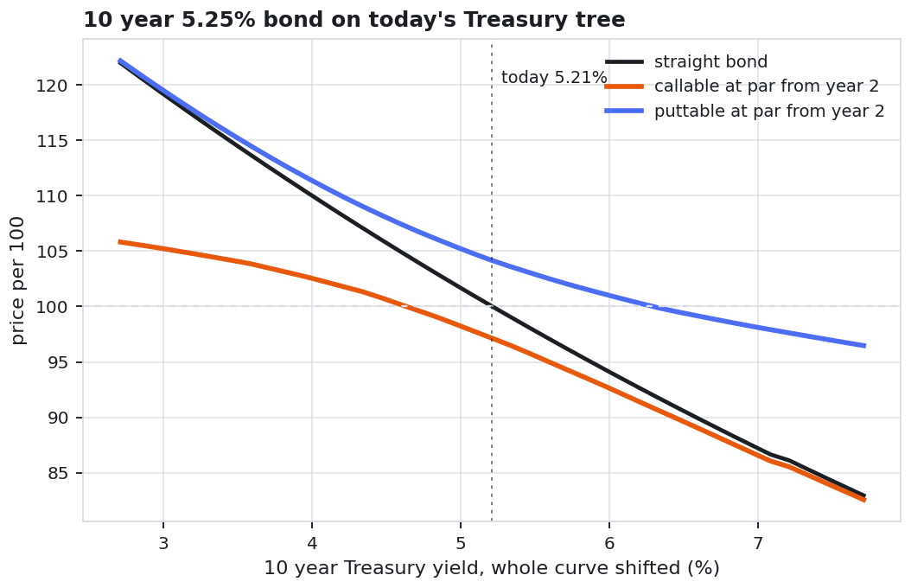
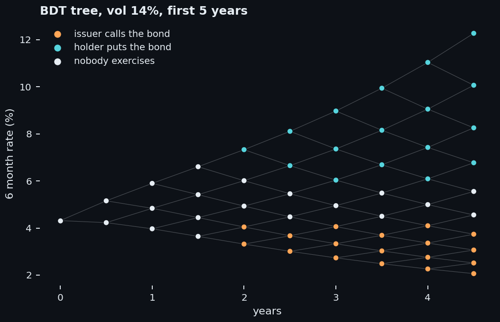
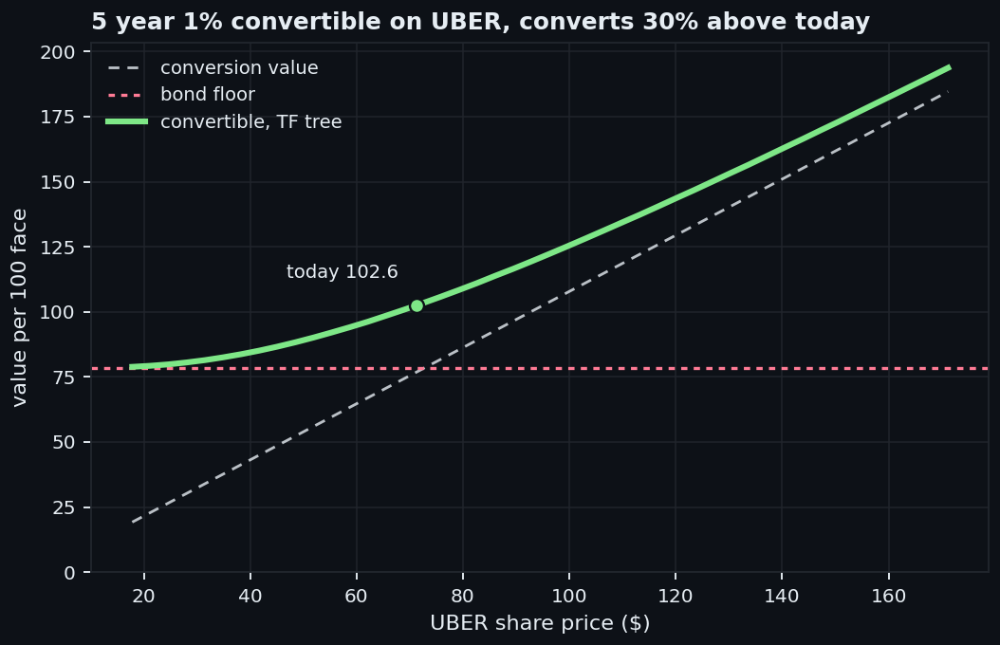
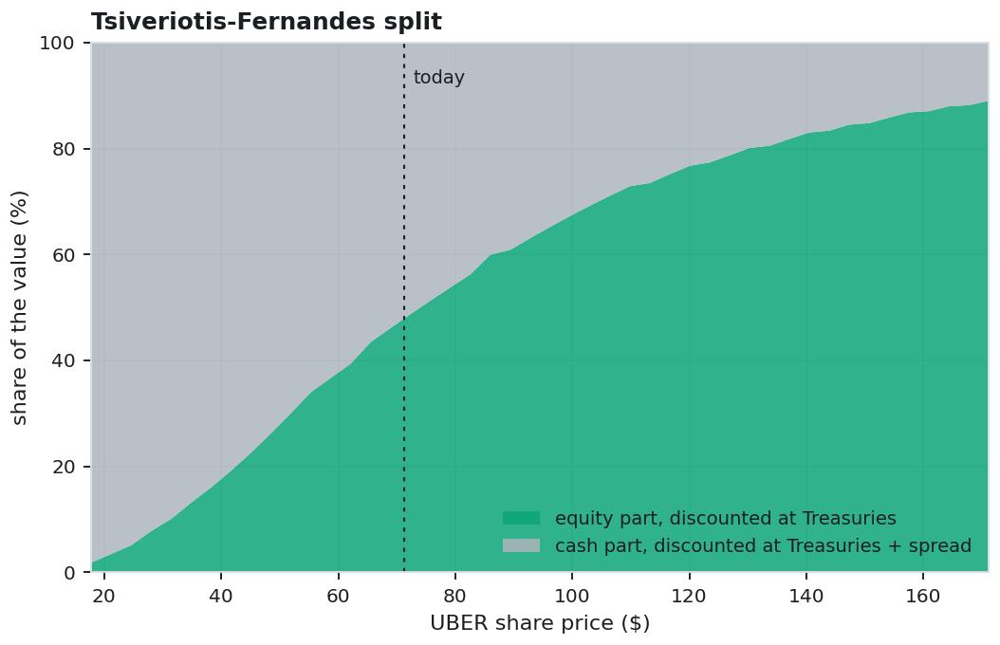
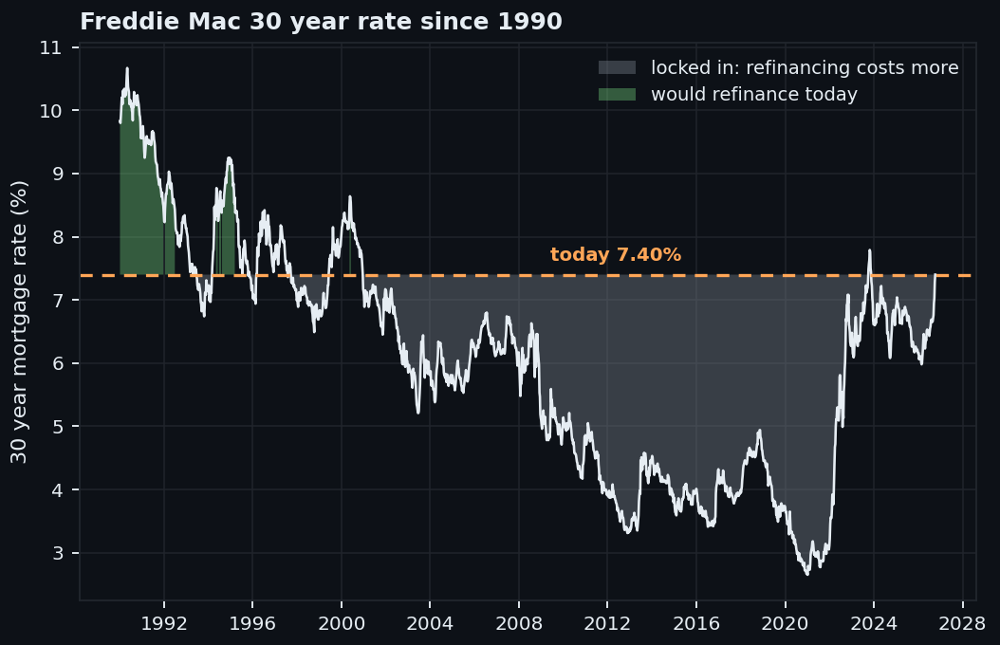
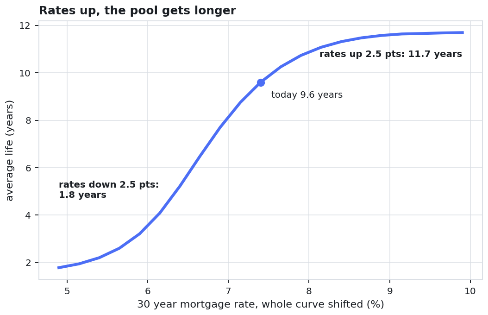
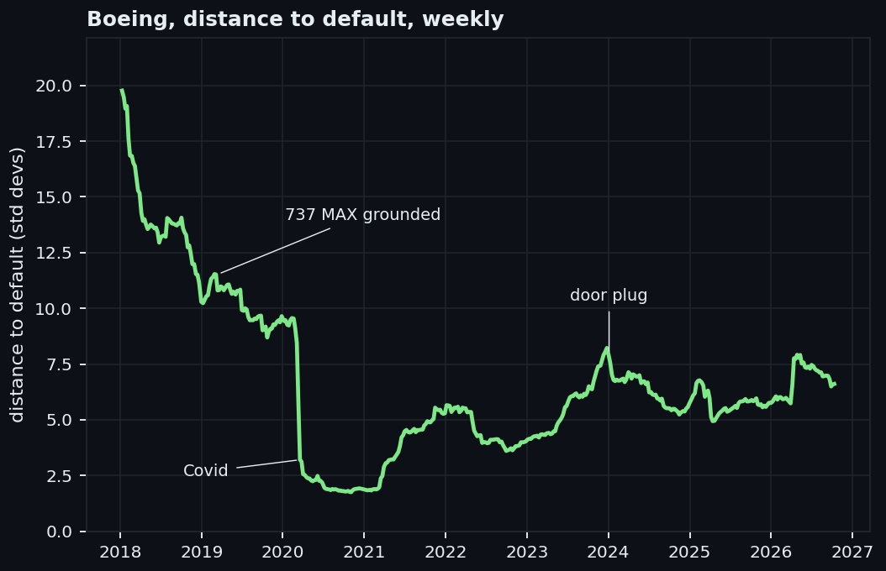
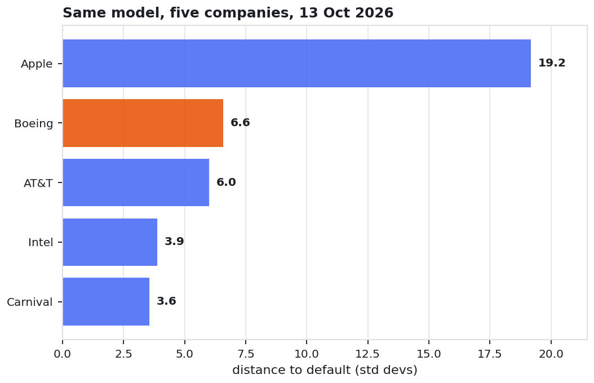
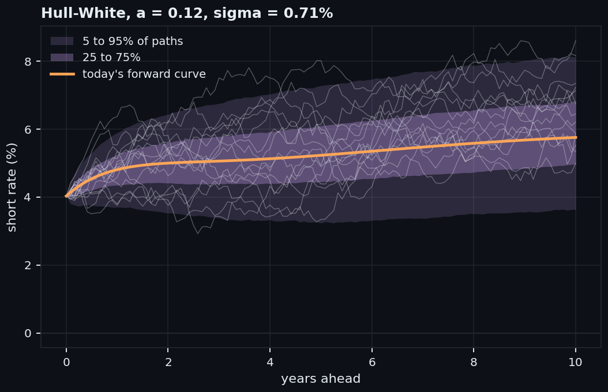
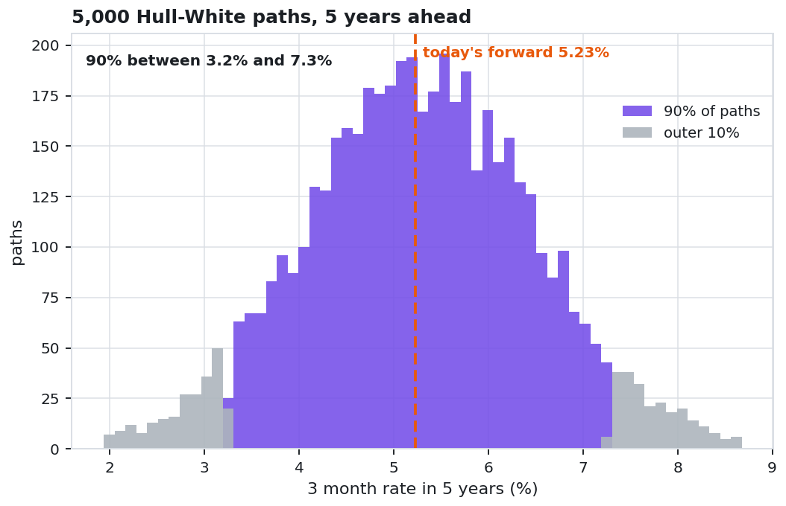

# Options models for fixed income

Five models for the options that sit inside bonds, each run on free data as of 13 October 2026:
callable and puttable bonds on a Black-Derman-Toy tree, convertibles priced the
Tsiveriotis-Fernandes way, the prepayment option inside a mortgage-backed security, Merton's
structural credit model, and Hull-White. Every number below comes out of `run_all.py`, and every chart is in `charts/`. Write-up
with the charts:
[Options models for fixed income](https://davidariasfinance.com/scripts/fixed-income-options-models/).

## Results

| Model | What it prices | Result on 13 Oct 2026 data |
|---|---|---|
| Black-Derman-Toy | 10 year 5.25% bond on the Treasury curve, call or put at par from year 2 | straight 100.02, callable 97.14, puttable 104.15 |
| Tsiveriotis-Fernandes | hypothetical 5 year 1% UBER convertible, converting 30% above the share price | 102.6, against a 78.4 bond floor and 76.9 of shares |
| MBS prepayment | new 30 year pool at the 7.40% Freddie Mac rate, investors paid 7.00% | rates down 1 point: +3.1, against +7.6 with no refinancing; rates up 1 point: -5.4 |
| Merton | Boeing, then Carnival, Intel, AT&T and Apple | Boeing 6.6 standard deviations from default, 1.75 on 3 Nov 2020 |
| Hull-White | short rate fitted on 3 month T-bills since 1990 | a 0.12 (half life 5.8 years), sigma 0.71%, 5 year zero within 0.5 bp |

### 1. Callable and puttable bonds

A callable lets the issuer buy the bond back at par, so the holder is short a call; a puttable
lets the holder sell it back, so the holder owns a put. A Black-Derman-Toy tree calibrated to
the Treasury curve (rate vol 14%, measured from the 1 year yield) puts the issuer's call at
2.88 per 100 and the holder's put at 4.14. The callable's price stalls as rates fall, the
puttable's price stops falling as rates rise.

 

### 2. Convertible bonds

Tsiveriotis and Fernandes split a convertible into the cash the issuer still owes, discounted
with credit risk (Treasuries plus the 1.03% ICE BofA BBB spread), and the part that ends up as
shares, discounted risk free. On UBER at $71.32 with 35% vol, the right to convert is worth
24.1 on top of the bond floor.

 

### 3. Mortgage-backed security prepayment option

Every US homeowner can repay at par any day, so an MBS holder is short thousands of calls.
Rates come from 4,000 Hull-White paths with the 10 year yield moving 67 bp a year, and a
simple S-curve decides who refinances. The pool's average life is 9.6 years today, 1.8 if rates
fall 2.5 points and 11.7 if they rise 2.5. Loans taken in 2020 and 2021 pay 2.65% to 3.65%,
deep out of the money at 7.40%.

 

### 4. Merton credit model

Shares are a call on the company's assets, struck at its debt, so a corporate bond is a safe
bond minus a put. With the KMV default point (debt due within a year plus half the rest),
Boeing's $147bn of shares and 34% equity vol back out $172bn of assets at 29% vol.

 

### 5. Hull-White

The short rate reverts at speed a toward a target path fitted so today's curve comes out
exactly. On 5,000 exact paths, 90% of outcomes put the 3 month rate between 3.2% and 7.3% in
five years.

 

## Run it

```bash
pip install -r ../requirements.txt
export SEC_USER_AGENT="Your Name your@email"   # the SEC API asks for a name and an email
python run_all.py                              # charts/ and charts/facts.json
```

Data is downloaded on the first run and cached in `data/`. Every series is cut at
`AS_OF` (13 Oct 2026 by default), so a later run gives the same numbers; set `AS_OF` to move
the date, or pass `--refresh` to download again.

| File | What it holds |
|---|---|
| `data.py` | FRED, Yahoo Finance and SEC company facts, cached and cut at `AS_OF` |
| `curve.py` | Treasury par yields bootstrapped to zeros, smoothed with Nelson-Siegel-Svensson |
| `callable_puttable.py` | Black-Derman-Toy tree and the bond pricer with call and put schedules |
| `convertible.py` | Tsiveriotis-Fernandes on a CRR tree |
| `mbs.py` | pool cash flows with the refinancing S-curve, priced on Hull-White paths |
| `merton.py` | the two Merton equations solved for asset value and vol, distance to default |
| `hull_white.py` | calibration, exact simulation, closed form zero yields |
| `run_all.py` | runs the five models in order |

## What the numbers do not claim

- **A real UBER bond.** The convertible is hypothetical: 5 years, 1% coupon, 30% conversion
  premium.
- **An MBS spread.** No free MBS prices exist, so the pool is priced at par to fix its spread.
  The results are price changes and the option's value, which barely depend on that choice.
- **One Hull-White vol everywhere.** The MBS paths use sigma 1.15%, set so the 10 year yield
  moves as much as it did over the past year. The T-bill sigma (0.71%) moves the 10 year only
  about 40 bp a year and leaves the refinancing option close to worthless.
- **A dealer prepayment model.** The S-curve has no burnout, seasonality or loan level data.
- **Real world default probabilities.** Distance to default uses the risk free drift, and the
  balance sheets enter at their period end, a month or so before they were filed.
- **Implied rate vols.** BDT and Hull-White take their vols from history (DGS1, DTB3, DGS10);
  swaption quotes are not free.

## Data

Treasury yields (H.15), the 3 month T-bill, the ICE BofA BBB spread and the Freddie Mac 30 year
mortgage rate come from [FRED](https://fred.stlouisfed.org); prices from Yahoo Finance; debt
and shares from SEC company facts. None of it is redistributed here: each source keeps its own
terms, and the code downloads it on the first run.

## Video

[Convertible and Callable Bonds: Pricing the Hidden Options](https://www.youtube.com/watch?v=aI240XlqgTw), three real bonds priced on free data. Its code is in [convertible-callable-bonds](../convertible-callable-bonds/).

## License

MIT, same as the rest of the repository.
